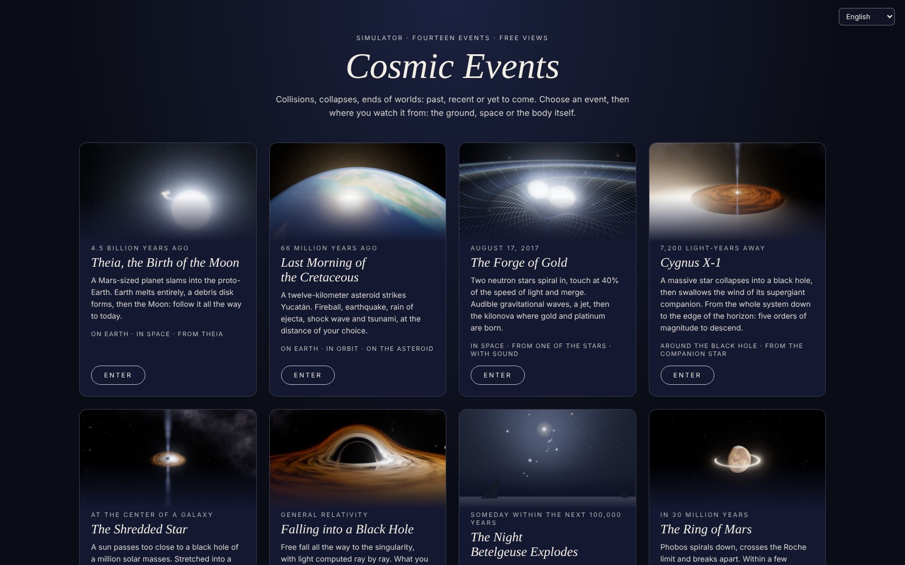
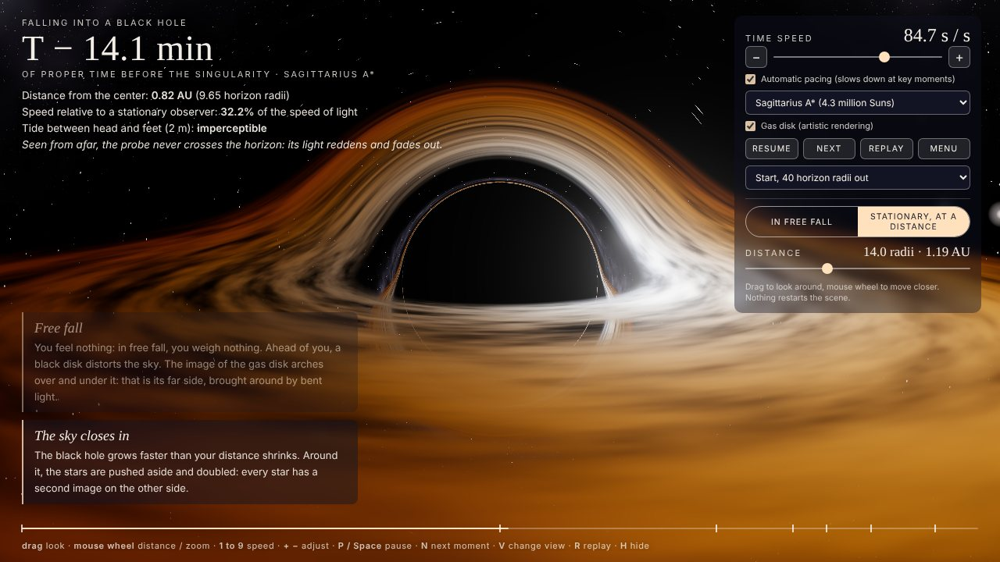
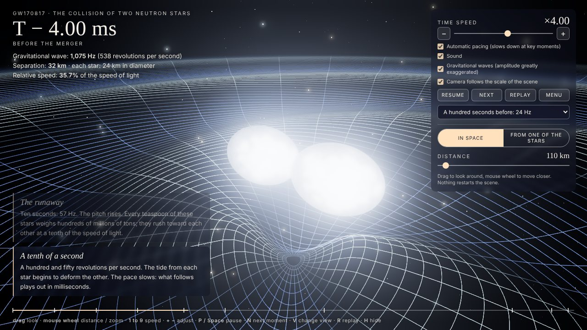
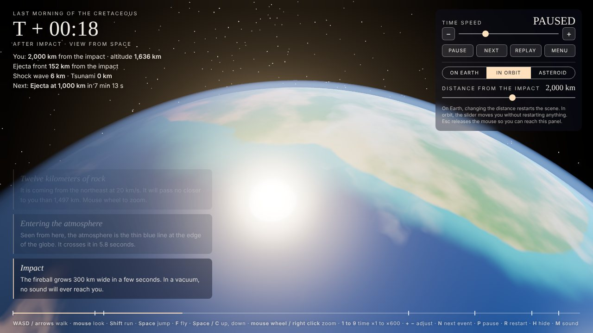
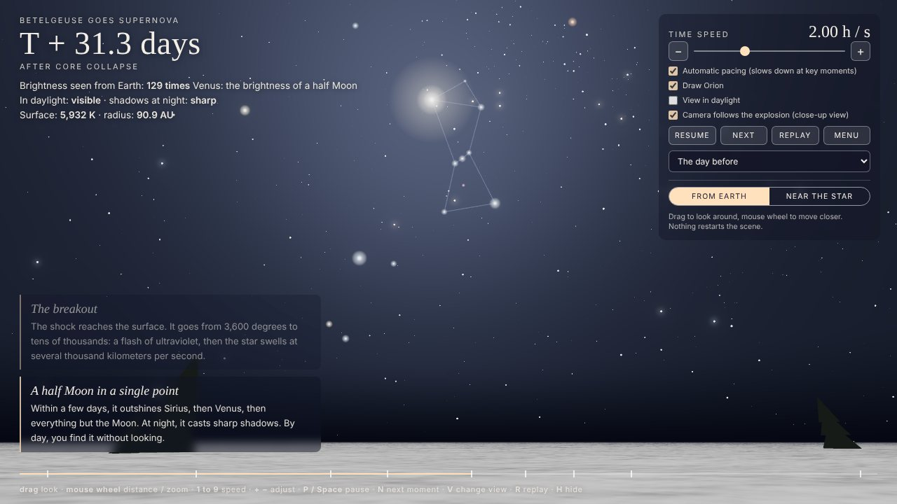
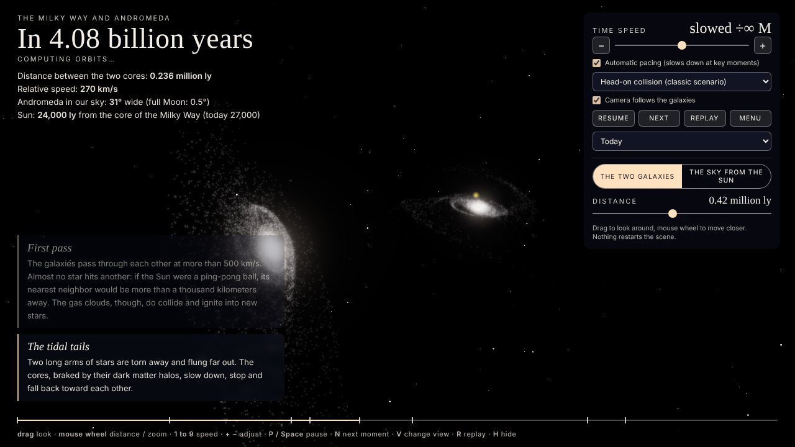
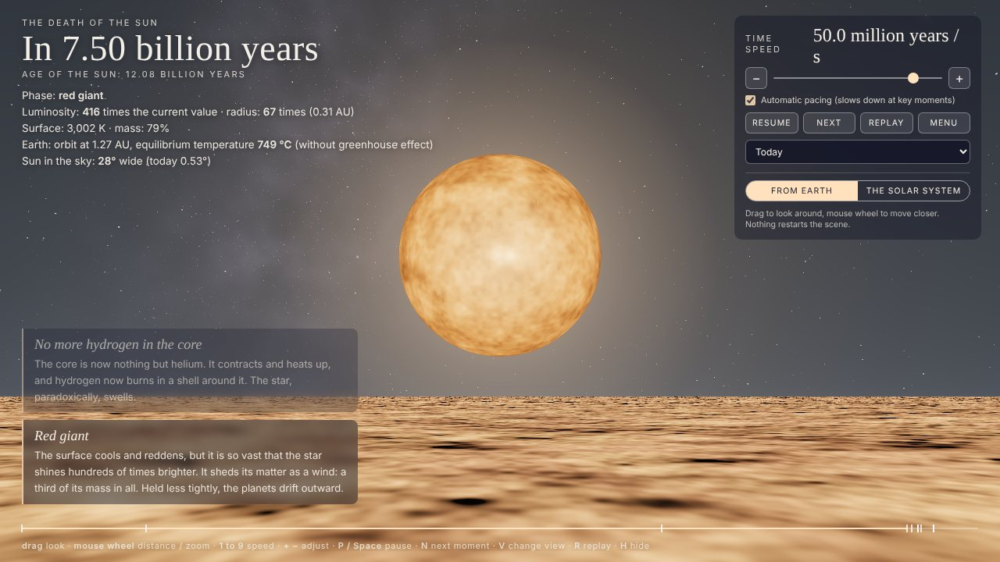
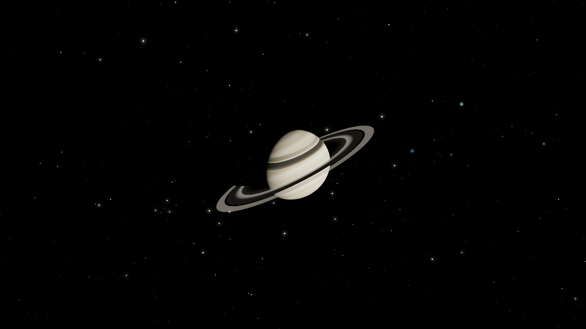

<p align="center"></p>

<h1 align="center">Événements cosmiques</h1>
<p align="center"><b>Quatorze événements cosmiques où l’on peut entrer.</b><br>
Collisions, effondrements et fins de mondes, simulés en 3D dans le navigateur, dans un seul fichier.</p>

<p align="center"><a href="https://intelligentrebel.github.io/cosmic-events/"><b>▶ L’ouvrir dans le navigateur</b></a> · <a href="README.md">English version</a></p>

---

Tenez-vous sur un banc de sable du Yucatán soixante secondes avant l’astéroïde. Regardez Theia emplir le ciel de la jeune Terre, puis suivez les débris jusqu’à ce qu’ils deviennent la Lune. Chevauchez un fragment de la comète Shoemaker-Levy 9 jusqu’à Jupiter. Franchissez l’horizon d’un trou noir, avec chaque rayon lumineux courbé comme le veut la relativité générale.

Chaque scène a une horloge que l’on peut ralentir dix mille fois ou pousser à cent millions d’années par seconde, plusieurs points de vue (le sol, l’espace, l’astre qui arrive), un panneau de données, et un journal qui explique ce que l’on voit au moment où cela se produit.

<p align="center"> </p>

## Les quatorze événements

| Quand | Événement | Ce que l’on voit |
|---|---|---|
| Il y a 4,5 milliards d’années | **Theia, la naissance de la Lune** | Une planète de la taille de Mars percute la proto-Terre ; la Terre fond, un disque de débris se forme, la Lune s’assemble et s’éloigne, jusqu’à aujourd’hui. |
| Il y a 66 millions d’années | **Dernier matin du Crétacé** | L’impact de Chicxulub à la distance de votre choix : boule de feu, séisme, pluie d’éjectas, onde de choc, tsunami. |
| Juillet 1994 | **La comète contre Jupiter** | Les fragments de Shoemaker-Levy 9 à leurs heures d’impact réelles, panaches et cicatrices. |
| 15 février 2013 | **Le matin de Tcheliabinsk** | Un astéroïde de 18 mètres plus brillant que le Soleil, les ombres qui tournent dans les rues, puis l’onde de choc deux minutes et demie plus tard. |
| 17 août 2017 | **La forge de l’or** | La fusion d’étoiles à neutrons GW170817 : les cent dernières secondes, l’onde gravitationnelle que l’on entend, le jet, la kilonova. |
| À 7 200 années-lumière | **Cygnus X-1** | Une étoile massive s’effondre en trou noir, puis se nourrit de sa compagne ; du système entier jusqu’à l’horizon. |
| Au cœur d’une galaxie | **L’étoile déchiquetée** | Une rupture par effet de marée : 52 000 fragments sur leurs orbites, le filament, le retour après 41 jours. |
| Relativité générale | **Tomber dans un trou noir** | La chute libre jusqu’à la singularité, avant, pendant et après l’horizon. |
| Un jour, d’ici 100 000 ans | **La nuit où Bételgeuse explose** | Orion avec une supernova sur l’épaule, des ombres la nuit, puis mille ans de nébuleuse. |
| Dans 30 millions d’années | **L’anneau de Mars** | Phobos descend en spirale, se disloque à la limite de Roche et devient un anneau. |
| Dans 4 milliards d’années | **Voie lactée contre Andromède** | 27 000 étoiles-tests intégrées en direct ; collision frontale ou frôlement, les deux scénarios. |
| Dans 7,6 milliards d’années | **La mort du Soleil** | Océans évaporés, géante rouge qui emplit le ciel, planètes englouties, flash de l’hélium, naine blanche. |
| Fiction | **Et si un trou noir délogeait Saturne ?** | Un trou noir de 300 mètres freine Saturne, qui tombe vers le Soleil et vient frôler la Terre. Onze corps intégrés pas à pas ; deux scénarios, dont un où la Lune est arrachée. Présenté clairement comme une fiction. |
| Fiction | **Et si un trou noir emportait le Soleil ?** | Un trou noir de quatre masses solaires passe à l’intérieur de l’orbite de Mars : le Soleil est arraché à 50 km/s et les planètes géantes restent sans étoile. Trois scénarios pour la Terre, selon l’endroit où elle se trouve ce jour-là. Point de départ inspiré de la trilogie *Black Hole* de Jason Thomson ; les paramètres et le calcul sont ceux de ce projet. |

<p align="center"> </p>
<p align="center"> </p>
<p align="center"></p>

## Ce qu’il y a dedans

- **Des points de vue libres** : depuis le sol, depuis l’espace, et depuis l’astre qui va frapper. On en change à tout moment, la scène ne redémarre pas.
- **Points d’intérêt** : dans chaque scène, une liste « Centrer sur… » (la comète, le point d’impact, une planète…) et des flèches au bord de l’écran qui indiquent où ils se trouvent ; une case les masque.
- **Le temps sous contrôle** : touches 1 à 9, un curseur, et un tempo automatique qui ralentit aux moments clés. Une liste de moments y mène directement.
- **Franc sur ce que l’on sait** : chaque scène dit ce qui est mesuré ou calculé (trajectoires, calendriers, ordres de grandeur, courbure de la lumière autour des trous noirs) et ce qui est une mise en scène. Les chiffres clés viennent de sources publiées, listées plus bas.
- **Un seul fichier, hors ligne** : tout le simulateur tient dans un fichier HTML d’environ 3 Mo, sans serveur, sans compte et sans accès réseau. Presque tout est procédural : les seuls fichiers image sont les cartes de Mars et de Phobos de la NASA.
- **11 langues** : English, 简体中文, Deutsch, Español, Português, Русский, Français, 日本語, 한국어, Italiano, Polski. Le simulateur suit la langue du navigateur (l’anglais sinon) ; on la change depuis le menu.

## L’utiliser

- **En ligne** : [intelligentrebel.github.io/cosmic-events](https://intelligentrebel.github.io/cosmic-events/), rien à installer.
- **Hors ligne** : téléchargez `cosmic-events-<version>.html` depuis la page [Releases](https://github.com/IntelligentRebel/cosmic-events/releases) et double-cliquez dessus. Une copie locale regarde, à l’ouverture, si GitHub propose une version plus récente (un clic suffit à désactiver cette vérification).

Glissez pour tourner le regard, molette pour approcher ou zoomer, **1 à 9** pour la vitesse du temps, **P** ou **Espace** pour la pause, **N** pour le moment suivant, **V** pour changer de vue, **H** pour masquer les panneaux. Une carte graphique aide : les scènes de trou noir tracent des rayons lumineux courbes pour chaque pixel.

## Assembler depuis les sources

Il faut Node.js 20 ou plus récent.

```
npm ci
node tools/build.mjs        # -> dist/index.html et dist/cosmic-events.html
node tests/smoke.mjs        # essai de bout en bout des scènes (demande Chrome ou Chromium)
```

Le code est écrit en français (variables, commentaires, textes). Chaque texte affiché passe par `T('…')` ou `TF('… {0} …', […])` ; les traductions sont dans `i18n/<langue>.json`, voir [i18n/README.md](i18n/README.md). Un nouvel événement, c’est un module dans `src/` bâti sur le socle commun (`src/kit.js` : temps, caméras, panneaux, journal), une ligne dans `src/app.js` et une carte dans `src/index.html`.

## Sources des chiffres clés

- GW170817 : [article de découverte LIGO/Virgo](https://arxiv.org/abs/1710.05832)
- Cygnus X-1 : [Miller-Jones et al. 2021](https://arxiv.org/abs/2102.09091)
- Tcheliabinsk : [synthèse Wikipédia des mesures publiées](https://en.wikipedia.org/wiki/Chelyabinsk_meteor)
- Shoemaker-Levy 9 : [heures d’impact, NASA NSSDC](https://nssdc.gsfc.nasa.gov/planetary/impact.html)
- Phobos : Black et Mittal 2015, [résumé](https://www.sciencedaily.com/releases/2015/11/151124143506.htm) ; cartes de Mars et de Phobos : [NASA 3D Resources](https://github.com/nasa/NASA-3D-Resources)
- Les deux scènes de passage d’un trou noir sont des fictions : aucune source publiée ne les décrit. Les points de départ sont choisis, la suite est une intégration newtonienne à N corps (`src/nbody.js`)
- Le Soleil : [Schröder et Smith 2008](https://arxiv.org/abs/0801.4031)
- Andromède : [Sawala et al. 2025](https://arxiv.org/abs/2408.00064)
- Bételgeuse : [Astronomy.com, d’après Goldberg et Bauer](https://www.astronomy.com/science/when-betelgeuse-goes-supernova-what-will-it-look-like-from-earth/)

Entre deux jalons publiés, les scènes interpolent, et plusieurs aspects (gaz, panaches, ville, nébuleuses) sont mis en scène. Une erreur ? Ouvrez une issue.

## Crédits

- Idée et direction : **Olivier Roland**. Code écrit avec **Claude** (Anthropic).
- Moteur 3D : [three.js](https://threejs.org/) (MIT), voir [THIRD_PARTY.md](THIRD_PARTY.md).

## Licence

Logiciel libre sous [licence publique générale GNU v3.0](LICENSE). Vous pouvez le copier, le modifier et le partager, à condition que votre version reste ouverte sous la même licence.
