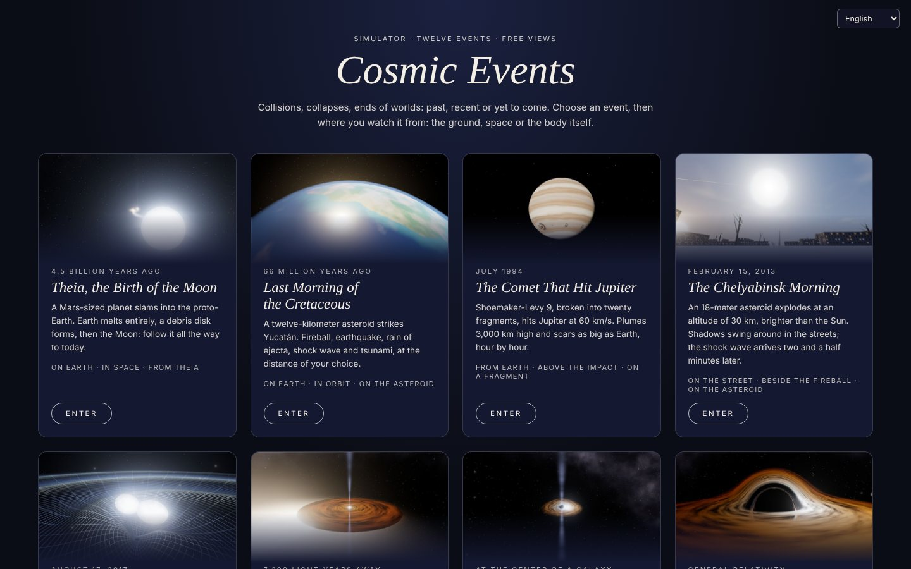
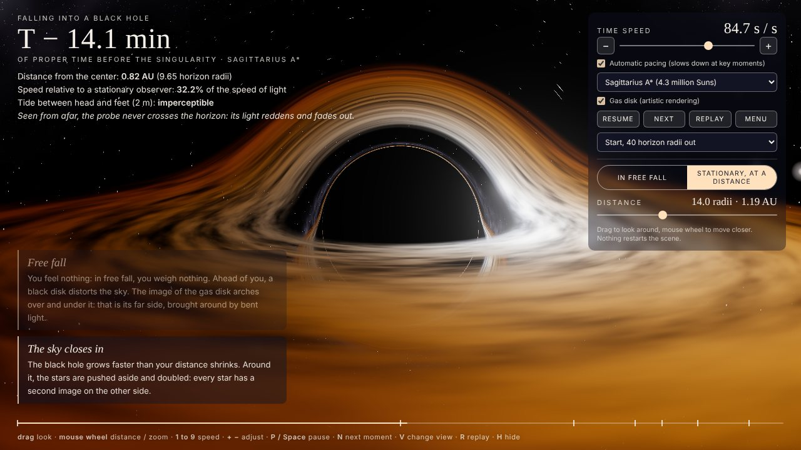

<p align="center"></p>

<h1 align="center">Cosmic Events</h1>
<p align="center"><b>Twelve cosmic events you can walk into.</b><br>
Collisions, collapses and ends of worlds, simulated in 3D in your browser, from a single file.</p>

<p align="center"><a href="https://intelligentrebel.github.io/cosmic-events/"><b>▶ Open it in your browser</b></a> · <a href="README.fr.md">Version française</a></p>

---

Stand on a sandbank in the Yucatán sixty seconds before the asteroid lands. Watch Theia fill the sky of the early Earth, then follow the debris until it becomes the Moon. Ride a fragment of comet Shoemaker-Levy 9 into Jupiter. Fall through the horizon of a black hole with every light ray bent the way general relativity says it is.

Each scene has a clock you can slow down ten thousand times or speed up to a hundred million years per second, several viewpoints (the ground, space, the incoming body itself), a data panel, and a journal that explains what you are looking at as it happens.

<p align="center"> </p>

## The twelve events

| When | Event | What you see |
|---|---|---|
| 4.5 billion years ago | **Theia, the birth of the Moon** | A Mars-sized planet hits the proto-Earth; the Earth melts, a debris disc forms, the Moon assembles and recedes, up to today. |
| 66 million years ago | **Last morning of the Cretaceous** | The Chicxulub impact at the distance you choose: fireball, earthquake, ejecta rain, blast wave, tsunami. |
| July 1994 | **The comet against Jupiter** | The fragments of Shoemaker-Levy 9, at their real impact times, plumes and scars. |
| 15 February 2013 | **The morning of Chelyabinsk** | An 18-metre asteroid brighter than the Sun, shadows sweeping the streets, and the blast wave two and a half minutes later. |
| 17 August 2017 | **The forge of gold** | The neutron-star merger GW170817: the last hundred seconds, the gravitational wave you can hear, the jet, the kilonova. |
| 7,200 light-years away | **Cygnus X-1** | A massive star collapses into a black hole, then feeds on its companion; from the whole system down to the horizon. |
| In a galaxy's core | **The star torn apart** | A tidal disruption event: 52,000 fragments on their orbits, the stream, the return after 41 days. |
| General relativity | **Falling into a black hole** | Free fall to the singularity, before, at and below the horizon. |
| Some day within 100,000 years | **The night Betelgeuse explodes** | Orion with a supernova on its shoulder, shadows at night, then a thousand years of nebula. |
| In 30 million years | **The ring of Mars** | Phobos spirals in, breaks up at the Roche limit and becomes a ring. |
| In 4 billion years | **Milky Way against Andromeda** | 27,000 test stars integrated live; head-on collision or near miss, both scenarios. |
| In 7.6 billion years | **The death of the Sun** | Oceans gone, red giant filling the sky, planets engulfed, helium flash, white dwarf. |

<p align="center"> </p>
<p align="center"> </p>

## What is in it

- **Free viewpoints**: from the ground, from space, and from the body that is about to hit. Change at any time, the scene does not restart.
- **Time under control**: keys 1 to 9, a slider, and an automatic tempo that slows down at the key moments. A list of moments jumps straight to them.
- **Honest about what is known**: each scene says what is measured or computed (trajectories, timings, orders of magnitude, the bending of light around the black holes) and what is an artistic rendering. Key figures come from published sources, listed below.
- **One file, offline**: the whole simulator is a single HTML file of about 2.5 MB, with no server, no account and no network access. Everything is procedural: there is not a single texture file.
- **11 languages**: English, 简体中文, Deutsch, Español, Português, Русский, Français, 日本語, 한국어, Italiano, Polski. It follows your browser's language (English otherwise); you can change it from the menu.

## Use it

- **Online**: [intelligentrebel.github.io/cosmic-events](https://intelligentrebel.github.io/cosmic-events/), nothing to install.
- **Offline**: download `cosmic-events-<version>.html` from the [Releases](https://github.com/IntelligentRebel/cosmic-events/releases) page and double-click it. A local copy checks GitHub for a newer version when it opens (one click turns that off).

Drag to look around, mouse wheel to move closer or zoom, **1 to 9** for the speed of time, **P** or **Space** to pause, **N** for the next moment, **V** to change viewpoint, **H** to hide the panels. A graphics card helps: the black-hole scenes trace curved light rays for every pixel.

## Build from source

You need Node.js 20 or later.

```
npm ci
node tools/build.mjs        # -> dist/index.html and dist/cosmic-events.html
node tests/smoke.mjs        # end-to-end test of the scenes (needs Chrome or Chromium)
```

The source is written in French (variables, comments, texts). Every displayed text goes through `T('…')` or `TF('… {0} …', […])`; translations live in `i18n/<language>.json`, see [i18n/README.md](i18n/README.md). A new event is one module in `src/` built on the shared kit (`src/kit.js`: time, cameras, panels, journal), one line in `src/app.js` and one card in `src/index.html`.

## Sources of the key figures

- GW170817: [LIGO/Virgo discovery paper](https://arxiv.org/abs/1710.05832)
- Cygnus X-1: [Miller-Jones et al. 2021](https://arxiv.org/abs/2102.09091)
- Chelyabinsk: [Wikipedia summary of the published measurements](https://en.wikipedia.org/wiki/Chelyabinsk_meteor)
- Shoemaker-Levy 9: [NASA NSSDC impact times](https://nssdc.gsfc.nasa.gov/planetary/impact.html)
- Phobos: Black & Mittal 2015, [summary](https://www.sciencedaily.com/releases/2015/11/151124143506.htm)
- The Sun: [Schröder & Smith 2008](https://arxiv.org/abs/0801.4031)
- Andromeda: [Sawala et al. 2025](https://arxiv.org/abs/2408.00064)
- Betelgeuse: [Astronomy.com on the Goldberg & Bauer estimates](https://www.astronomy.com/science/when-betelgeuse-goes-supernova-what-will-it-look-like-from-earth/)

Between published milestones the scenes interpolate, and several looks (gas, plumes, city, nebulae) are staged. Found a mistake? Please open an issue.

## Credits

- Idea and direction: **Olivier Roland**. Code written with **Claude** (Anthropic).
- 3D engine: [three.js](https://threejs.org/) (MIT), see [THIRD_PARTY.md](THIRD_PARTY.md).

## License

Free software under the [GNU General Public License v3.0](LICENSE). Fork it, modify it, share it, as long as your version stays open under the same license.
